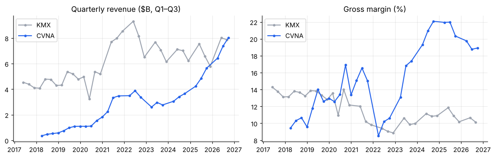
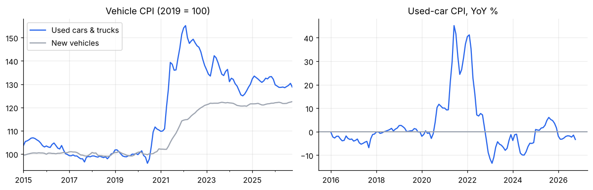
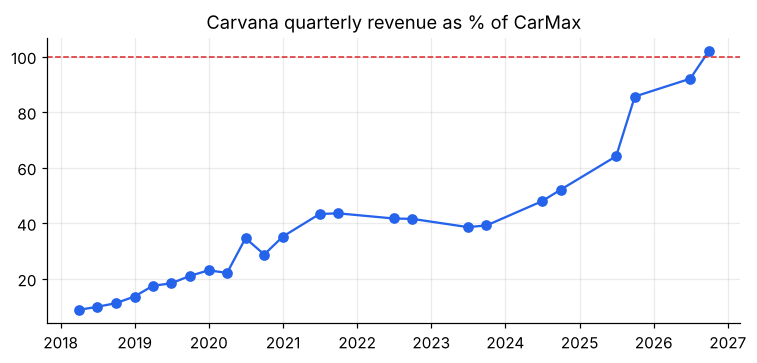

# Used-Car Pricing Cycle vs. CarMax & Carvana — Alt-Data Research Note

A short equity-research-style note built only from public data: the BLS used-car price index (via FRED) and
quarterly revenue / gross profit from SEC EDGAR XBRL filings for **CarMax (KMX)** and **Carvana (CVNA)**.

## Key takeaways (data through Oct 2026 / Sep-2026 quarter)

| Signal | Reading |
|---|---|
| Used-car CPI vs 2019 average | **+55%** at the Feb 2022 peak → **+29%** now (−17% from peak, −3.3% YoY) |
| Used / new vehicle price ratio | 0.95 (2019) → 1.29 (peak) → **1.00** (Oct 2026) |
| Carvana revenue as % of CarMax (matched quarters) | **48%** (Jun-2024 qtr) → **102%** (Sep-2026 qtr: $8.04B vs $7.88B) |
| Carvana revenue growth YoY (2025–26 quarters) | **+42% to +55%** |
| Gross margin | Carvana **~19–22%** vs CarMax **~10–12%** |
| Correlation of KMX YoY revenue with used-car CPI YoY | **0.80** same quarter, 0.35 at a 2-quarter lag |

**View:** used-car prices have normalised but not reset, removing the pandemic scarcity tailwind. Carvana has reached
revenue parity with CarMax while keeping a much higher gross margin; its margin drift from 22% to ~19% is the key
risk to watch. CarMax's sales are tightly tied to the used-price cycle, so falling used prices are a headwind.

| | |
|---|---|
|  |  |

## Data
| File | Source |
|---|---|
| `data/fred_cpi_vehicles.csv` | FRED series CUSR0000SETA02 (used cars & trucks), CUSR0000SETA01 (new vehicles), CPIAUCSL (all items); Oct 2025 all-items value missing at source |
| `data/sec_quarterly.csv` | SEC EDGAR `companyconcept` API — `Revenues` / `RevenueFromContractWithCustomerExcludingAssessedTax` and `GrossProfit`, 3-month periods only |

CarMax's fiscal year ends in February, so its quarters end one month before Carvana's; each Carvana quarter is paired with
the CarMax quarter ending about a month earlier. Fourth quarters are only in annual 10-K totals and are not used.

## Files
`used_car_research_note.ipynb` (analysis with outputs) · `used_car_research_note.py` (script version) · `charts/`

## How to run
`pip install -r requirements.txt` then `jupyter nbconvert --to notebook --execute used_car_research_note.ipynb`.

*Not investment advice — a portfolio exercise in building an alt-data view from public sources.*

**Tools:** Python (pandas, matplotlib), FRED, SEC EDGAR XBRL API, Jupyter
